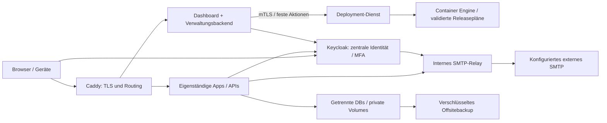

# Zielarchitektur und Entscheidungen

> **Nachtrag vom 01.11.2026 — Komponentenentscheidung geändert.** Siehe
> [scope-decision.md](scope-decision.md), Beschluss D2: **Keycloak entfällt in der
> ersten Ausbaustufe.** Schulwissens OIDC-Flow ist generisch (Discovery, Issuer-Prüfung,
> PKCE S256) und war gegen die Nextcloud-App „OIDC Identity Provider" gebaut; die Schule
> betreibt bereits eine Nextcloud. Das spart den gesamten IdP-Betrieb und geschätzt
> 0,8–1,25 GiB RAM. Keycloak bleibt die dokumentierte Option, falls SSO später auf mehr
> Apps ausgeweitet wird. Ebenfalls geändert: Backup erfolgt generisch nach Speichertyp
> statt als Adapter pro App (D6). Die übrige Architektur gilt unverändert — insbesondere
> eigenständige Images statt Monorepo, was den Standalone-Betrieb erst möglich macht.

Stand 01.11.2026. **Beobachtet:** Alle 14 Anwendungen haben serverseitige Funktionen; keine ist anhand des geprüften Codes einfach als statisches Frontend zu zählen. PostgreSQL 16 wird von Schulwissen, Fahrrad und Leseflux verwendet, abgen deklariert PostgreSQL 18. Mehrere andere Apps verwenden SQLite; Grundschultafel speichert Nutzer und Notizbücher als Dateien. SL-Journal verwendet SQLCipher und ein Einzelkonto. Belege: [Matrix](repository-matrix.csv), [Einzelberichte](apps/).

**Empfehlung/Entwurf:** Ein neues Plattform-Repository orchestriert eigenständige versionierte App-Images, ohne deren Fachmodelle zu verschmelzen. App-Releases werden über Digest und eine getestete Kompatibilitätsmatrix freigegeben. Ein Plattformrelease kann einzelne Apps unverändert weiterverwenden. Gemeinsamer Vertrag statt Kopieren von Quellcode in ein zentrales Backend.

Ein Monorepo erleichterte koordinierte Querschnittsänderungen, würde hier aber Python-/Node-/pnpm-/npm-/UV-Toolchains, private Inhalte und unterschiedliche Releasezyklen koppeln. Die gemeinsame Orchestrierung gewinnt für eine Schule mit 24 Lehrkräften und maximal zehn gleichzeitig aktiven Personen. Versionierte gemeinsame Integrationsbibliotheken dürfen optional sein; jede App behält Standalone-Konfiguration und lokale Notfallanmeldung.

## Primärkomponenten und Alternativen

**Entwurf:** Docker Compose auf einem einzelnen Server. Betrieb ist für dieses kleine Lastprofil überschaubar; keine Kubernetes-Steuerung, Cluster-DB oder externe Queue ohne Befund. Compose ist kein Hochverfügbarkeitsverfahren. Native systemd-Dienste wären möglich, verursachten bei 14 unterschiedlichen Apps aber mehr Hostabhängigkeiten. Die [offizielle Produktionsanleitung](https://docs.docker.com/compose/how-tos/production/) beschreibt Single-Server-Betrieb und Produktions-Overrides; sie beweist keine Kapazität dieser Plattform.

**Entwurf:** Caddy als zentraler Proxy. Explizit erzeugte Konfiguration statt Docker-Discovery reduziert Socketprivilegien. Automatisches TLS, Zertifikatszustand persistent, Admin-API nur intern. Traefik wäre bei häufig wechselnden Diensten nützlich; hier überwiegt der Zusatznutzen gegenüber Konfigurations-/Providerkomplexität nicht. Öffentliche Zertifikate setzen geeignete Domains, DNS und erreichbare Challengewege voraus; [Caddy-Dokumentation](https://caddyserver.com/docs/automatic-https). Domainumstellungen siehe operations.md.

**Entwurf:** Keycloak als IdP, ein Realm für die Schule, separater OIDC-Client je App. Schulwissen hat bereits Authlib/OIDC, die übrigen Apps brauchen unterschiedlich große Adapter. Das passt zu nativer OIDC-Integration mit Standardbibliotheken; [Keycloak empfiehlt Ökosystembibliotheken](https://www.keycloak.org/securing-apps/overview). Ein Keycloak-Dienst plus PostgreSQL genügt als Ausgangspunkt, zusätzliche HA-Komponenten erst bei entsprechendem Ziel. authentik ist eine brauchbare Alternative mit flexiblen Proxyflows; die [Compose-Anleitung](https://docs.goauthentik.io/install-config/install/docker-compose/) verlangt eigene Infrastruktur. Hier ist Proxy-SSO für die meisten Besitzmodelle ohnehin unzureichend. Keycloak spart keine Appanpassungen; Realm-/Client-/MFA-/Backupbetrieb verursacht laufende Wartung.

**Entwurf:** Postfix als internes Submission-/Smarthost-Relay, kein Internet-MX. Dauerhafte Queue und retryfähige Annahme, Absenderbindung und Limits; vorhandene SMTP-Adapter in Schulwissen, Schulanmeldung, Kompetenz-Manager, Losverkauf und Schulhelfer anschließen, außerdem IdP. Appseitige Outbox bleibt nötig, solange Mail vor Relayannahme verloren gehen kann. Keine neue Mailfunktion in Apps ohne Versandbedarf. Mailpit ausschließlich in Tests, ohne externen Upstream. Offizielle [Postfix-Zugriffskontrollen](https://www.postfix.org/SMTPD_ACCESS_README.html) waren beim Browserabruf nicht verfügbar; konkrete Relaykonfiguration muss vor Freigabe gegen offizielle Dokumentation und Negativtests geprüft werden.

**Entwurf:** Schlankes serverseitiges Dashboard (z. B. Django mit BFF-Sessions und eigener kleinen PostgreSQL-Datenbank), keine zweite Passwortverwaltung. Benutzer/Gruppen aus Keycloak, lokale Plattform-DB nur Appmanifest, gewünschter/aktueller Zustand, Audit, Auftragsstatus und Freigabeprojektion. Adminoberfläche getrennt von normalen Kacheln. Die Verwendung von Django nutzt vorhandene Projekterfahrung, ohne Schulwissen zum Plattformkern umzubauen. Dashboard/Deployment-Dienst sind noch nicht implementiert.

## Daten- und Vertrauensgrenzen

Eine Installation pro Schule; echte Appmandantenfähigkeit ist kein Bestandteil dieser Architektur. PG16 für kompatible Apps und Plattform/IdP nur nach Versionskompatibilität teilen, mit je eigener DB, Rolle, Passwort und Schema-Migrationsrecht nur für die eigene DB. Maximalverbindungen budgetieren: anfangs z. B. vier Apppools mit je 10 + IdP 15 + Betrieb 10 = 65; reale Worker-/Poolzahlen vor Setzen von max_connections prüfen. PG18 für abgen getrennt bis getesteter gemeinsamer Upgradepfad vorliegt. Keine globalen SQL-Zugänge für Dashboard oder andere Apps.

SQLite lokal auf SSD/Blockvolume, nicht NFS; eine schreibende Appinstanz als Ausgangspunkt. WAL und busy_timeout mildern Schreibkonkurrenz, ersetzen keine fachliche Atomarität. Schulkasse/Losverkauf nutzen BEGIN IMMEDIATE; Schuleva verbraucht TAN und schreibt Antwort in getrennten Schritten, daher gezielter Fehler-/Parallelitätstest vor Freigabe. Bestehendes SQLite bei zehn Nutzern nicht vorsorglich ersetzen. SQLCipher bleibt eigene Daten-/Schlüsselgrenze.

Nur Proxyports öffentlich. Je App eigener Proxyzugang und Backendnetz; Datenbanken nur für jeweilige berechtigte Dienste erreichbar. Eingehende vertrauensbezogene Header entfernen und Proxyadressen explizit zulassen. Containersystembenutzer, read-only Root-FS soweit möglich, begrenzte tmpfs, keine privilegierten Appcontainer; Uploads niemals ausführbar. Ausgehende Verbindungen nach Funktion: SMTP nur Relay, KI nur bei bewusster Freigabe, keine Produktivzugänge in Tests. Kompromittierter Proxy oder Deployment-Dienst bleibt erhebliches Risiko: Letzterer kontrolliert letztlich Container und deren Daten.

Keine Garantie gleichwertigen vollständigen Self-Hostings aller optionalen Funktionen: gswb-Handschriftanalyse verwendet Gemini/Vertex; Mock ist kein Ersatz. Grundschultafel verwendet YouTube/Galerie/Fontdienst, andere Apps OSM-Kacheln. Kernbetrieb lokal ist oft möglich; externe Inhalte lokal ersetzen oder Funktion sichtbar abschalten. Kein nachgewiesener lokaler Modell-/GPU-Workload.

## Aktuelle Quellen und Versionsgrenze

Offizielle Dokumentation am 01.11.2026 abgerufen. GitHub-Releases der Hersteller lieferten Caddy v2.11.7, Keycloak 26.8.1 und Mailpit v1.33.0; siehe [release-metadata.json](evidence/release-metadata.json). Das sind geprüfte Kandidaten, keine getestete Releasekombination. Images vor Nutzung zusätzlich per Digest fixieren und Sicherheitsupdates kontrolliert freigeben. [Keycloak Containerbetrieb](https://www.keycloak.org/server/containers) und [Dimensionierung](https://www.keycloak.org/high-availability/single-cluster/concepts-memory-and-cpu-sizing) liefern Betriebsgrundlagen; Referenzlasten werden hier nicht als Mindestbedarf übernommen.
